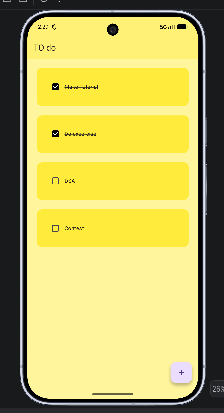
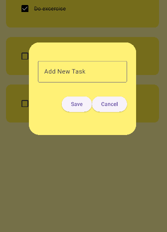
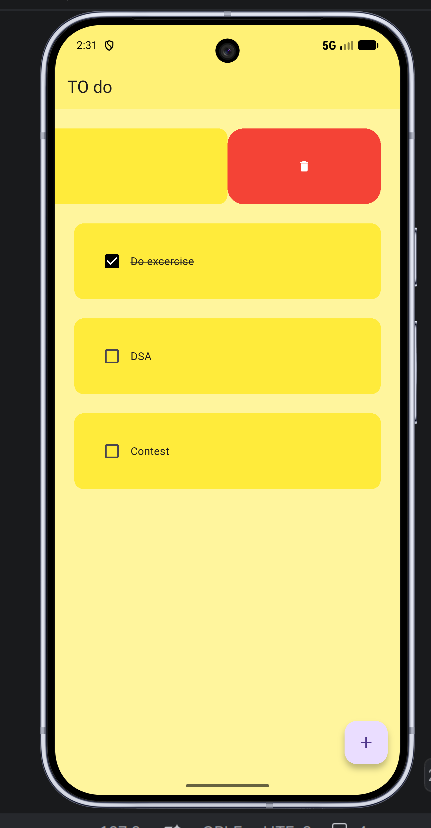

📝 Flutter To-Do App

A simple and beginner-friendly To-Do application built with Flutter and Dart.

The app allows users to create tasks, mark tasks as completed, and delete tasks. It uses Hive for local data persistence, so tasks remain available after restarting the application.

✨ Features

➕ Add new tasks

✅ Mark tasks as completed

🗑️ Delete tasks using swipe actions

💾 Store tasks locally using Hive

📱 Simple and responsive Flutter UI

⚡ Works offline

🎨 Clean yellow-themed interface

🛠️ Tech Stack

Flutter

Dart

Hive – Local database/storage

Hive Flutter – Flutter integration for Hive

Flutter Slidable – Swipe-to-delete functionality

📂 Project Structure

lib/
│
├── main.dart
├── home_page.dart
│
├── data/
│   └── database.dart
│
└── utilities/
├── dialog_box.dart
└── todo_tile.dart

main.dart

Initializes Flutter and Hive, opens the local Hive box, and starts the application.

home_page.dart

Contains the main application logic:

Loading saved tasks

Adding new tasks

Marking tasks as completed

Deleting tasks

Updating the local database

data/database.dart

Handles local task storage with Hive.

The application uses the Hive box:

mybox

and stores the task list using:

TODOLIST

utilities/dialog_box.dart

Contains the dialog used to enter a new task, with Save and Cancel actions.

utilities/todo_tile.dart

Builds the individual task UI with:

Checkbox

Task name

Completed-task strikethrough

Swipe-to-delete action

🔄 How It Works

             Start App
                 │
                 ▼
          Initialize Hive
                 │
                 ▼
           Open mybox
                 │
                 ▼
        Load Saved Tasks
                 │
                 ▼
            Home Page
                 │
       ┌─────────┼─────────┐
       ▼         ▼         ▼
    Add Task  Complete   Delete
       │        Task       │
       └────────┼──────────┘
                ▼
          Update Hive
                │
                ▼
       Data Persists Locally

🚀 Getting Started

Prerequisites

Make sure you have installed:

Flutter

Dart SDK

Android Studio or another Flutter-supported IDE

Android emulator or a physical Android device

1. Clone the Repository

git clone https://github.com/prem70198/flutter-Todo-app.git

2. Open the Project

cd flutter-Todo-app

3. Install Dependencies

flutter pub get

4. Run the Application

flutter run

📸 Screenshots

Add screenshots of the application here.

For example:

screenshots/
├── home_screen.png
├── add_task.png
└── completed_task.png

Then display them in this section using:

!
!

📚 What I Learned

This project helped me practice:

Flutter widget development

Dart programming

Stateful widgets

setState() and UI updates

TextEditingController

Dialogs

ListView.builder

Checkbox handling

Swipe actions with flutter_slidable

Local data persistence with Hive

Basic Flutter project organization

🔮 Future Improvements

Possible improvements for future versions:

Edit existing tasks

Task categories

Due dates and reminders

Task priority

Search and filtering

Dark mode

Better animations

Cloud synchronization

User authentication

Task notifications

👨‍💻 Author

Prem Kumar

GitHub: @prem70198

⭐ If you found this project useful, consider giving the repository a star!